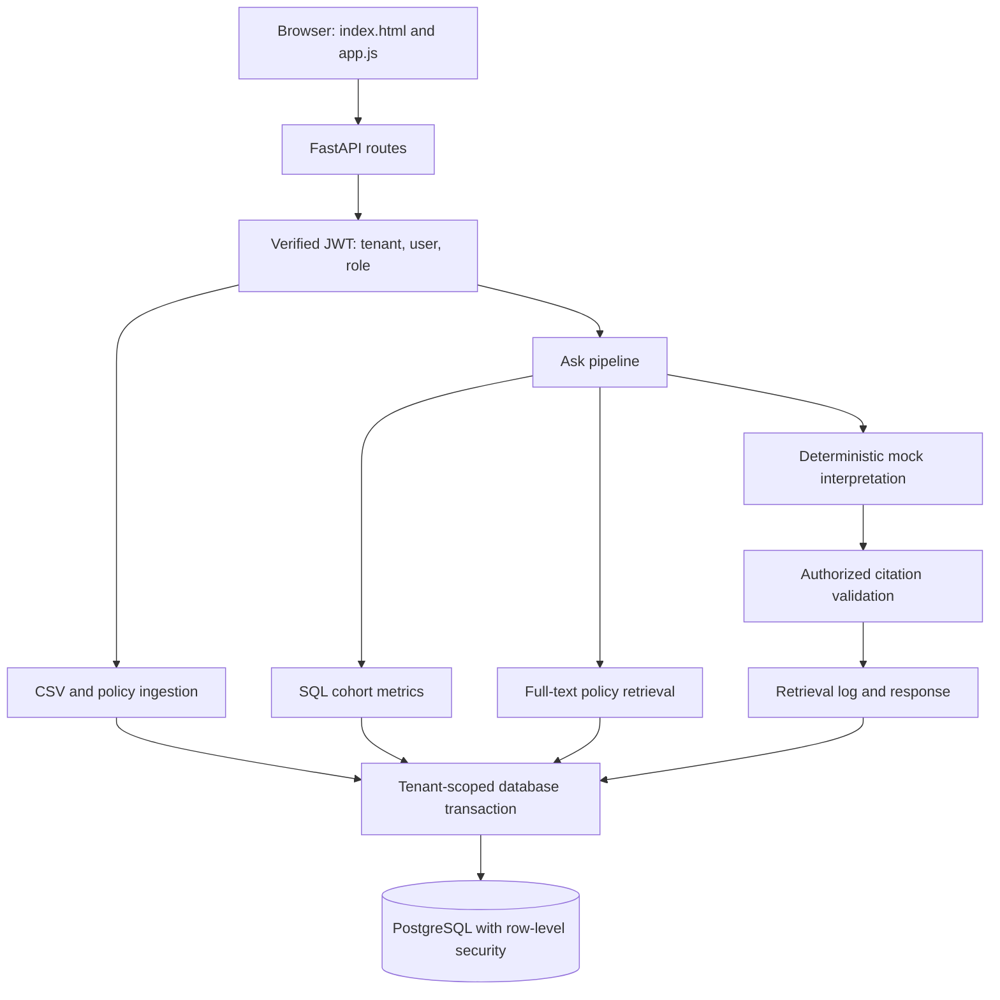

# File guide

This guide explains every tracked file, how requests move through the application,
and which implementation commits introduced the major capabilities. Paths are
relative to the repository root. Empty `__init__.py` files mark Python packages;
the application behavior lives in the named modules beside them.

## Start reading here

1. [README.md](../README.md): setup, example questions, checks, and current limits.
2. [app/main.py](../app/main.py): application entry point and router registration.
3. [app/api/pipeline.py](../app/api/pipeline.py): authenticated HTTP endpoints.
4. [app/auth/jwt.py](../app/auth/jwt.py), [app/db.py](../app/db.py), and
   [migration 0001](../migrations/versions/0001_init.py): tenant identity and database isolation.
5. [app/ingest/operational.py](../app/ingest/operational.py): the main CSV import path.
6. [app/ask/pipeline.py](../app/ask/pipeline.py): calculations, evidence, interpretation, and logs.
7. [tests/test_isolation.py](../tests/test_isolation.py) and
   [tests/test_pipeline.py](../tests/test_pipeline.py): intended behavior and failure cases.

## How the pieces connect

An upload passes through request limits, JWT verification, CSV validation, and
tenant-scoped persistence. One operational CSV row becomes a submission, its job,
and any recorded interview/start outcomes in a single transaction.

An Ask request calculates metrics and retrieves evidence in one repeatable-read
transaction. The mock provider formats an interpretation, the citation validator
checks its references, and a retrieval log records the result. The shipped provider
does not call an external LLM; retrieval uses PostgreSQL full-text search rather
than embeddings.

## Root configuration and runtime

| File | Responsibility |
| --- | --- |
| [README.md](../README.md) | Main project overview, local startup, authentication, sample workflow, checks, and limitations. |
| [pyproject.toml](../pyproject.toml) | Python 3.12 requirement, application and development dependencies, pytest markers, and Ruff settings. |
| [uv.lock](../uv.lock) | Resolved dependency versions used by `uv sync --locked` and the container build. |
| [.python-version](../.python-version) | Selects Python 3.12 for tools that honor this file. |
| [.env.example](../.env.example) | Documents environment variable names with blank credentials; real values are generated locally. |
| [.gitignore](../.gitignore) | Excludes local credentials, virtual environments, caches, logs, and generated Python files from Git. |
| [.gitattributes](../.gitattributes) | Normalizes text and keeps shell, Python, and YAML files on LF line endings. |
| [.dockerignore](../.dockerignore) | Excludes Git metadata, local credentials, virtual environments, and caches from the Docker build context. |
| [Dockerfile](../Dockerfile) | Builds the Python application image, installs locked dependencies, and runs Uvicorn as a non-root user. |
| [docker-compose.yml](../docker-compose.yml) | Defines PostgreSQL, one-shot migrations, API, optional test service, health dependencies, and persistent storage. |
| [alembic.ini](../alembic.ini) | Alembic migration directory and logging configuration; database credentials come from application settings. |

The local `.env`, `.venv/`, `.git/`, and test/lint caches are runtime or developer
artifacts, not tracked application files. Database records live in the Compose
PostgreSQL volume, not in the synthetic fixture CSVs after import.

## Application entry point and persistence

| File | Responsibility |
| --- | --- |
| [app/__init__.py](../app/__init__.py) | Marks the application as a Python package. |
| [app/main.py](../app/main.py) | Creates FastAPI, registers routers and middleware, serves the page and static files, exposes `/api/me`, and sanitizes database exceptions. |
| [app/config.py](../app/config.py) | Validates environment settings and secret lengths, constructs the SQLAlchemy database URL, and caches settings. |
| [app/db.py](../app/db.py) | Creates the database engine and transaction-scoped tenant/user/role context; supports repeatable-read snapshots for answers. |
| [app/models.py](../app/models.py) | SQLAlchemy models for sources, jobs, submissions, outcomes, policy chunks, and retrieval logs, with tenant-aware keys and relationships. |

## HTTP API and authentication

| File | Responsibility |
| --- | --- |
| [app/api/__init__.py](../app/api/__init__.py) | Marks the HTTP API package. |
| [app/api/health.py](../app/api/health.py) | Process liveness and database readiness checks, including migration revision and application database privileges. |
| [app/api/middleware.py](../app/api/middleware.py) | Enforces the request body size limit and adds browser security and no-cache headers. |
| [app/api/pipeline.py](../app/api/pipeline.py) | Routes CSV/policy uploads, outcomes, Ask, metrics, source listing, and authorized retrieval history to their services. |
| [app/auth/__init__.py](../app/auth/__init__.py) | Marks the authentication package. |
| [app/auth/principal.py](../app/auth/principal.py) | Defines the immutable authenticated tenant ID, user ID, and allowed role values. |
| [app/auth/jwt.py](../app/auth/jwt.py) | Verifies bearer token signature, issuer, audience, expiry, and required claims, then constructs the principal used by protected endpoints. |

Tenant identity comes from a verified token. Client-selected headers and uploaded
fields cannot switch the authenticated tenant. Application filters and PostgreSQL
row policies both constrain access; an admin is still limited to their own tenant.

## Ingestion, calculations, and answers

| File | Responsibility |
| --- | --- |
| [app/ingest/__init__.py](../app/ingest/__init__.py) | Marks the ingestion package. |
| [app/ingest/operational.py](../app/ingest/operational.py) | Parses and validates the consolidated 13-column CSV, checks related job/event values, and maps rows into normalized records atomically. |
| [app/ingest/schemas.py](../app/ingest/schemas.py) | Validated models for job, submission, and outcome inputs, including identifiers and timestamp rules. |
| [app/ingest/service.py](../app/ingest/service.py) | Shared provenance, record upserts, legacy type-specific CSV ingestion, policy chunk replacement, source listing, and new-outcome persistence. |
| [app/metrics/__init__.py](../app/metrics/__init__.py) | Marks the metrics package. |
| [app/metrics/service.py](../app/metrics/service.py) | Selects comparison periods, calculates tenant/role-scoped cohort conversion and recorded status/rejection counts, and builds operational evidence. |
| [app/retrieval/__init__.py](../app/retrieval/__init__.py) | Marks the retrieval package. |
| [app/retrieval/service.py](../app/retrieval/service.py) | Ranks authorized policy chunks with PostgreSQL English full-text search, provides a labelled context fallback, and writes retrieval logs. |
| [app/ask/__init__.py](../app/ask/__init__.py) | Marks the question-answering package. |
| [app/ask/schemas.py](../app/ask/schemas.py) | Validates question, job title, comparison dates, cutoff date, and the optional cross-tenant test target. |
| [app/ask/pipeline.py](../app/ask/pipeline.py) | Coordinates scope checks, metrics, policy retrieval, mock interpretation, citation validation, and audit logging within a database snapshot. |
| [app/ask/citation_validator.py](../app/ask/citation_validator.py) | Rejects claims with missing citations or references outside the evidence retrieved for the request; it does not prove factual entailment. |
| [app/llm/__init__.py](../app/llm/__init__.py) | Marks the interpretation-provider package. |
| [app/llm/base.py](../app/llm/base.py) | Defines the provider protocol for converting computed metrics and evidence into cited claims. |
| [app/llm/mock.py](../app/llm/mock.py) | Produces deterministic cited explanations of metrics, pending queues, recorded rejection reasons, and policy context without an external model. |

## Browser interface

| File | Responsibility |
| --- | --- |
| [app/templates/index.html](../app/templates/index.html) | Page structure for connecting a demo identity, uploading evidence, asking questions, adding outcomes, and reviewing access history. |
| [app/static/app.js](../app/static/app.js) | Browser state, bearer-token requests, upload/outcome forms, metric and evidence rendering, retrieval history, and the cross-tenant denial probe. |
| [app/static/app.css](../app/static/app.css) | Layout, typography, responsive behavior, and visual styling for the demo page. |

## Schema migrations and local scripts

| File | Responsibility |
| --- | --- |
| [migrations/env.py](../migrations/env.py) | Connects Alembic to application settings and model metadata, using the `hireos` schema for migration state. |
| [migrations/script.py.mako](../migrations/script.py.mako) | Template used when generating new Alembic migration files. |
| [migrations/versions/0001_init.py](../migrations/versions/0001_init.py) | Creates source provenance and tenant/role read/write policies, forces row-level security, and grants application privileges. |
| [migrations/versions/0002_pipeline.py](../migrations/versions/0002_pipeline.py) | Adds jobs, submissions, outcomes, policy chunks, and retrieval logs, with tenant-aware links, indexes, row policies, and grants. |
| [scripts/create_env.py](../scripts/create_env.py) | Generates random local database passwords and a JWT signing secret in an ignored `.env`; does not overwrite an existing file or print credentials. |
| [scripts/init-db.sh](../scripts/init-db.sh) | Initializes separate migrator/application database roles, schema privileges, and the optional pgvector extension on first database startup. |
| [scripts/demo_token.py](../scripts/demo_token.py) | Prints a short-lived signed token for a synthetic tenant/user and selected role; keeps the signing secret out of output. |
| [scripts/generate_temp_fixtures.py](../scripts/generate_temp_fixtures.py) | Generates the temporary Tenant A/B operational CSVs, their policy examples, and the separate outcome example. |
| [scripts/seed.py](../scripts/seed.py) | Imports temporary Tenant A/B operational data and policies through the application ingestion services; leaves the new-outcome example for the freshness demo. |

The vector extension is installed for possible future work. Current retrieval
does not perform vector search or download an embedding model.

## Synthetic datasets and examples

| File | Responsibility |
| --- | --- |
| [fixtures/temporary/README.md](../fixtures/temporary/README.md) | Describes the temporary synthetic data contract, expected metrics, and replacement boundaries. |
| [fixtures/temporary/tenant_a/operations_a.csv](../fixtures/temporary/tenant_a/operations_a.csv) | Tenant A's primary submission/job/outcome sample for the conversion and freshness walkthrough. |
| [fixtures/temporary/tenant_a/policy_a.md](../fixtures/temporary/tenant_a/policy_a.md) | Synthetic Tenant A process guidance used to demonstrate authorized policy retrieval. |
| [fixtures/temporary/tenant_b/operations_b.csv](../fixtures/temporary/tenant_b/operations_b.csv) | Distinct Tenant B operational sample used to demonstrate tenant separation. |
| [fixtures/temporary/tenant_b/policy_b.md](../fixtures/temporary/tenant_b/policy_b.md) | Synthetic Tenant B policy that must remain inaccessible to Tenant A. |
| [fixtures/temporary/tenant_c/README.md](../fixtures/temporary/tenant_c/README.md) | Setup and expected behavior for the smaller seven-submission Tenant C sample. |
| [fixtures/temporary/tenant_c/operations_c.csv](../fixtures/temporary/tenant_c/operations_c.csv) | Standalone seven-submission operational example for another synthetic tenant. |
| [fixtures/temporary/new_outcome.json](../fixtures/temporary/new_outcome.json) | New interview request used to show that subsequent answers reflect newly persisted outcomes. |
| [fixtures/temporary/examples/README.md](../fixtures/temporary/examples/README.md) | Explains the difference between a fresh corrected import and updating an existing dataset without deleting outcomes. |
| [fixtures/temporary/examples/operations_a_corrected.csv](../fixtures/temporary/examples/operations_a_corrected.csv) | Corrected operational CSV for demonstrating update semantics and retained event history. |

## Tests

| File | Responsibility |
| --- | --- |
| [tests/conftest.py](../tests/conftest.py) | Shared FastAPI client and single-connection database fixture; prevents database access in tests marked `unit`. |
| [tests/test_auth.py](../tests/test_auth.py) | JWT validation, malformed/expired identity handling, and rejection of tenant/role overrides through headers. |
| [tests/test_health.py](../tests/test_health.py) | Readiness behavior and verification that the application database user cannot bypass row-level security. |
| [tests/test_isolation.py](../tests/test_isolation.py) | Cross-tenant read/write denial, minimum-role visibility, viewer write denial, and identity reset after commit/rollback. |
| [tests/test_csv_validation.py](../tests/test_csv_validation.py) | Consolidated CSV schema, fixture contracts, event/date consistency, citation handling, and browser-shell checks that do not require PostgreSQL. |
| [tests/test_pipeline.py](../tests/test_pipeline.py) | End-to-end ingestion, calculations, citations, freshness, denied access, source visibility, atomic updates, cutoff dates, and policy-injection scenarios. |

Run `uv run pytest -m unit -q` for independent checks. Database behavior requires
the real Compose database: `docker compose --profile test run --rm tests`.
The unit suite alone does not verify PostgreSQL policies or SQL aggregation.

## Documentation

| File | Responsibility |
| --- | --- |
| [docs/API.md](API.md) | Endpoint reference, exact operational CSV schema, field mappings, request examples, response semantics, and error codes. |
| [docs/DESIGN.md](DESIGN.md) | Data model, conversion definition, snapshots, retrieval choices, security controls, and explicit demo limitations. |
| [docs/DEMO.md](DEMO.md) | Demo walkthrough covering setup, uploads, calculations, freshness, and tenant/role isolation. |
| [docs/FILE_GUIDE.md](FILE_GUIDE.md) | This complete file inventory, suggested reading order, request flow, and implementation history. |

## Implementation history

Use the short hashes below to locate each change in Git history.
Documentation improvements follow this implementation history.

| Commit | Main responsibility |
| --- | --- |
| `21e8261` - Initialize Python project and basic FastAPI application | Project configuration and application foundation. |
| `4b87e65` - Docker setup and tenant-isolated authentication | Local services, authentication, migrations, and tenant/role isolation. |
| `918d21b` - Ingestion and evidence-backed conversion analysis | Evidence persistence, deterministic metrics, retrieval, and cited answers. |
| `843e74a` - Demo interface and reviewer documentation | Browser workflow and API/design/demo documentation. |
| `e285b43` - Validate and import 13-column operational CSVs | Consolidated CSV ingestion and normalization. |
| `79949bd` - Recorded rejection reasons with citations | Source-backed rejection summaries in calculated results and interpretation. |
| `18ec7a0` - One operational CSV and import counts in UI | Browser support for consolidated imports and import feedback. |
| `df521d6` - Single-CSV tenant samples and correction example | Synthetic operational datasets and update examples. |
| `e8cce46` - Generate and seed consolidated operational data | Fixture generation and application-service seeding scripts. |
| `28d1e92` - CSV validation, freshness, and access isolation tests | Regression coverage for data contracts, updates, and authorization. |
| `d9b8b1b` - CSV schema and reviewer walkthroughs | Usage, contract, and walkthrough explanations for the consolidated workflow. |
